<p align="center">
  
</p>
<h1 align="center">WonderBox</h1>
<p align="center">
  A native macOS toolkit for monitoring, cleanup and everyday maintenance.<br>
  See what your Mac is doing. Choose what stays. Keep the useful controls in your menu bar.
</p>
<p align="center">
  
  
  
  
  
</p>
<p align="center">
  English · <a href="README.zh-CN.md">简体中文</a><br>
  <a href="https://github.com/jasonwong1991/WonderBox/releases/latest">Download</a> ·
  <a href="#features">Features</a> · <a href="#installation">Installation</a> ·
  <a href="#build-and-test">Build &amp; test</a>
</p>

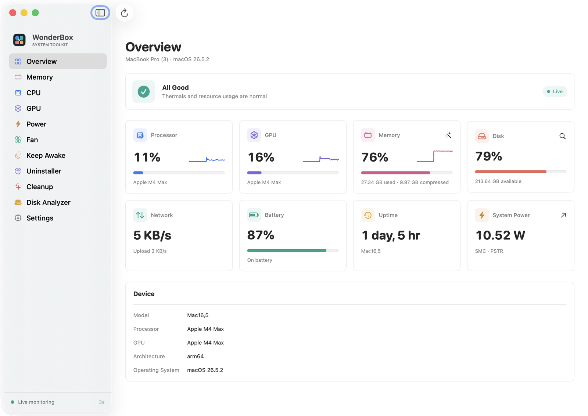

Screenshots show the current source build on one Mac, with chosen settings—not necessarily defaults. Readings and sensor availability vary by device. See the [capture notes](docs/SCREENSHOTS.md).

## At a glance

| Monitor | Maintain | Stay in control |
| --- | --- | --- |
| CPU/GPU charts and app rankings | Memory optimization with before/after results | Optional CPU, RAM and power menu-bar labels |
| Memory pressure, compression and swap | Standard/deep cleanup with item selection | Keep awake and optional launch at login |
| System/CPU/GPU power history | App uninstall and related-file review | Opt-in uninstall watcher and automatic cleanup |
| Temperatures and fan RPM | Folder-by-folder disk analysis | English/简体中文, light/dark themes, four accents |

**Release:** [1.2.3 · build 123](https://github.com/jasonwong1991/WonderBox/releases/tag/v1.2.3) · [release notes](docs/releases/v1.2.3.md).
**New in the working tree:** optional **system power in the menu bar**, off by default. Build from source to try it; the linked 1.2.3 archive predates this addition.

Scans and diagnostics stay on this Mac. Update checks contact GitHub; exported logs are shared only when you send them. No account, telemetry or automatic log upload.

## Features

### Menu bar: CPU, RAM and system power

In **Settings → Always Available**, enable any combination of:

- **Show CPU usage in menu bar** — overall processor utilization, 0–100%.
- **Show memory usage in menu bar** — App + Wired + Compressed as a fraction of physical memory.
- **Show system power in menu bar** — the Power page's system sensor, in watts, for example `PWR 18.3 W`.

<p>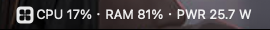</p>

All three are **independent and off by default**. A combined label looks like `CPU 12% · RAM 64% · PWR 18.3 W`. Changes apply immediately and persist after relaunch. Hiding the shortcut preserves your choices.

The label refreshes about every **3 seconds**, including with the main window closed. Only enabled readings are sampled; power reads the SMC **PSTR** system sensor without starting CPU/GPU energy subscriptions, process scans or power history. Disabling all values or hiding the shortcut stops this sampler. Sleep clears values; wake starts fresh. Missing sensors show `—`, and CPU waits for a measured baseline rather than showing a made-up zero.

Choose **Color** or **Monochrome** for the icon; monochrome follows the system menu-bar appearance. Click it to open the compact dashboard:

<p align="center">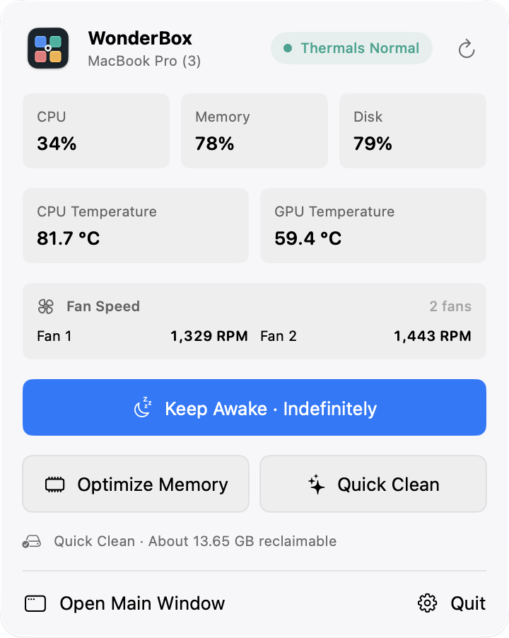</p>

The panel includes CPU/memory/disk usage, available CPU/GPU temperatures, fan RPM, keep awake, memory optimization and Quick Clean with a reclaimable-space estimate. The estimate is refreshed after cleanup; actual reclaimed space may differ.

### CPU, GPU and memory

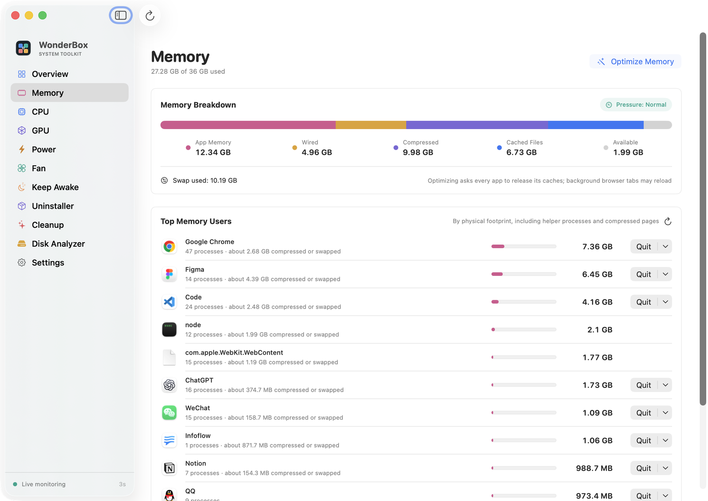

- **CPU/GPU:** rolling 60-second charts with time/percentage axes; searchable app rankings include helper processes and offer quit/force quit. In the *app ranking*, one fully occupied CPU core is 100%, so multi-core apps can exceed 100%. GPU context totals are not the same as whole-device utilization; unsupported drivers show `—`.
- **Memory:** App, Wired, Compressed, Cached Files and Available, plus swap and the kernel's memory-pressure level. Per-app physical footprint rolls helper processes into their host app and estimates compressed/swapped memory.
- **Optimization:** the privileged helper requests system-wide memory-pressure relief, then purges file cache. The result reports per-category before/after values and app responses. Reclaimed memory varies with workload; no fixed saving is promised.
- **Overview:** CPU, memory, disk, network, battery where present and uptime including sleep. The health banner takes memory pressure into account, not only thermals.

<table><tr>
  <td width="50%">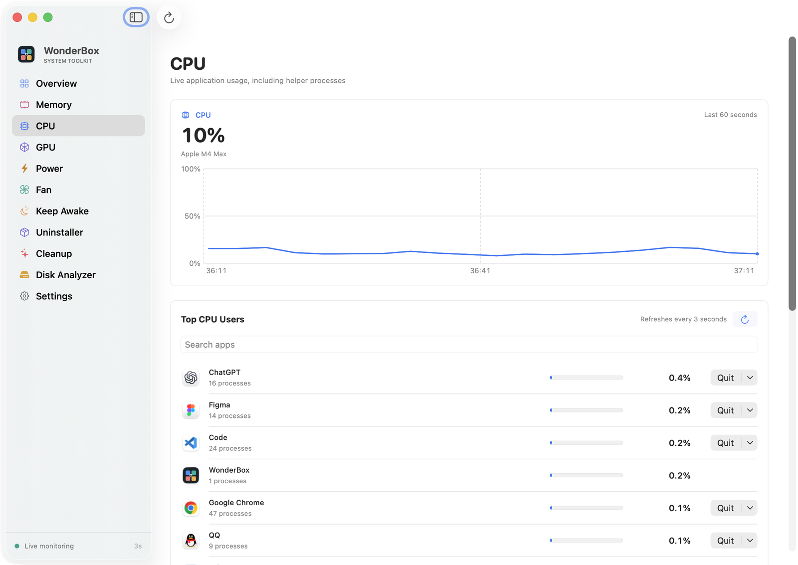</td>
  <td width="50%">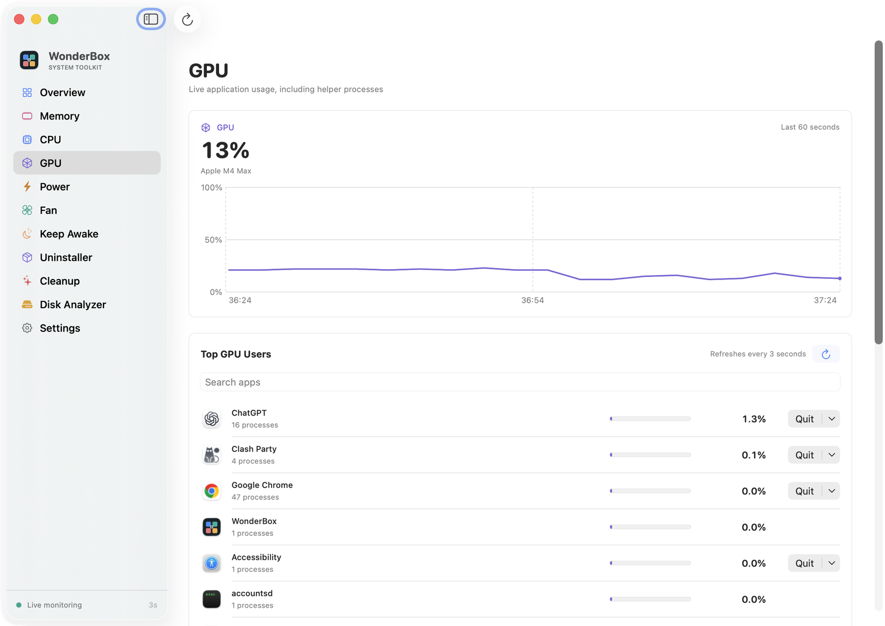</td>
</tr></table>

### Power and temperatures

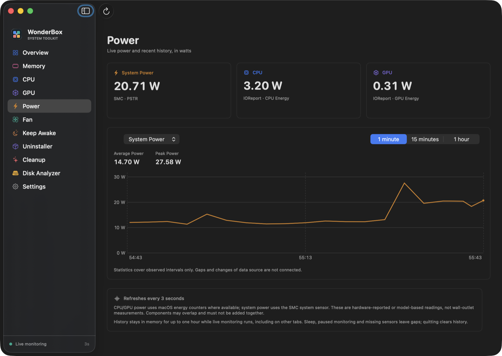

- **Power:** current system, CPU and GPU watts, plus **1-minute / 15-minute / 1-hour** history, observed-interval averages and peaks. History is held in memory while live monitoring runs; pauses/sleep leave gaps and quitting clears it. The menu-bar system reading has its own lightweight lifecycle and does not keep this history running.
- **Sources:** optional IOReport energy counters divided by the actual interval, plus supported SMC readings. System power comes from PSTR, not CPU + GPU, battery charging rate or adapter input. Readings are hardware/model estimates, **not wall-outlet measurements**; component scopes may overlap. CPU-package fallbacks are labeled.
- **Compatibility:** available counters vary by Mac and macOS. Missing, invalid or stale values show `—`; a measured zero remains zero. Sandboxed builds leave private-API power readings unavailable. The 1.2.3 M6/macOS 27.2 path is exact-build gated; runtime measurement on the reporting M6 remains unverified. See [compatibility notes](docs/DISTRIBUTION.md#m6--macos-272-cpu-energy-123).
- **Fan page:** CPU/GPU temperature summaries, individually available sensors and live RPM. Recognized Intel sensors receive core numbers; other sensors retain their keys. No missing cores or fan watts are invented from estimates.

<table><tr>
  <td width="50%">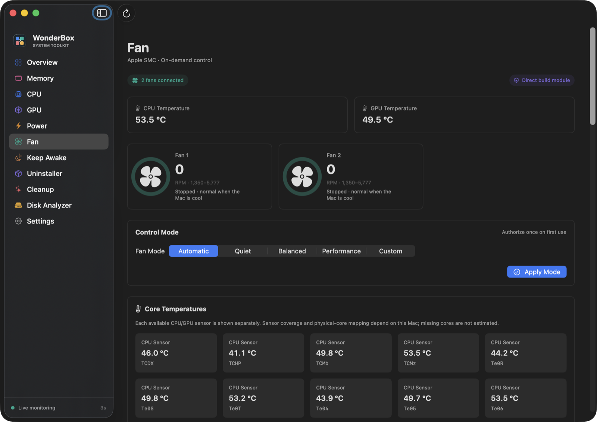</td>
  <td width="50%">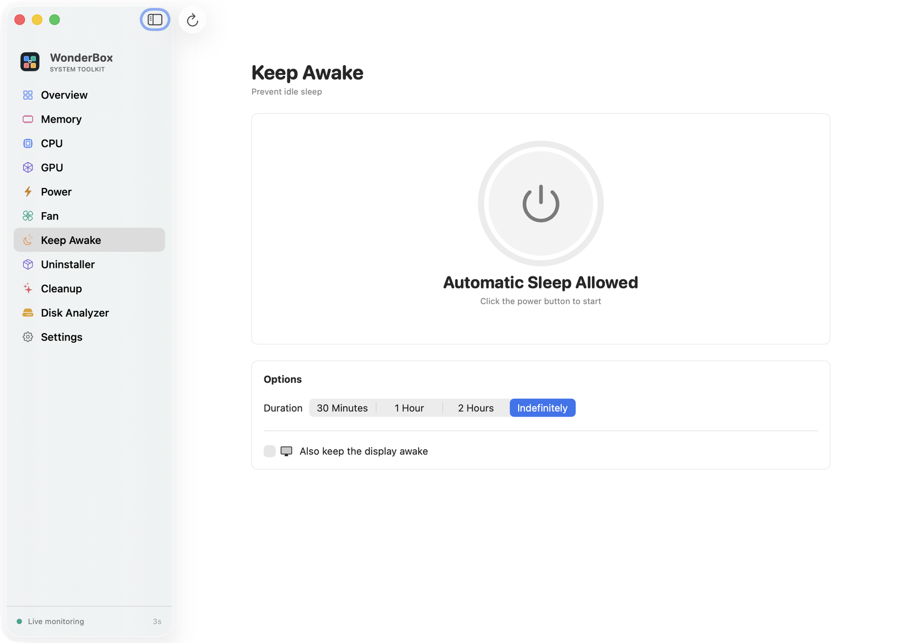</td>
</tr></table>

Fan control offers automatic, quiet, balanced, performance and custom modes **where hardware allows writes**; opening the page only reads sensors. Keep awake uses IOKit assertions, with 30-minute / 1-hour / 2-hour / indefinite durations and an optional keep-display-on setting.

### Cleanup, without the guessing

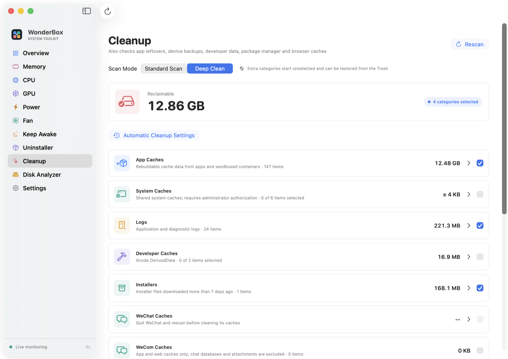

| Scan | Scope |
| --- | --- |
| Standard | User and sandbox-container caches, logs, Xcode DerivedData, installers older than 7 days, Trash |
| Deep additions | Package-manager caches; Chromium/Electron caches; simulator and DeviceSupport files; likely app leftovers; local device backups; partial downloads |
| Separately opt-in | WeChat and WeCom application/web caches, excluding chat databases and downloaded attachments |

Package-manager coverage includes npm, pnpm, yarn, bun, uv, Cargo, Go, Gradle, Maven and CocoaPods download caches—not installed runtimes, toolchains or Docker virtual disks. ZIPs count as installers only with actual installer content or standard bundle metadata, not merely an installer-looking parent directory.

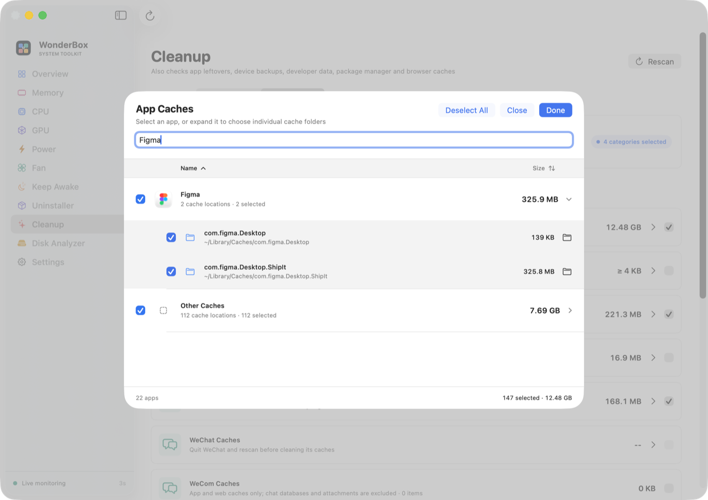

Expand categories to choose individual items. App caches are grouped by app name/icon; search and **Select All / Deselect All** affect visible results. Click **Name** or **Size** to sort while preserving selection and expansion. **Done** saves the draft; **Close / Escape** discards it. Partial sizes carry `≥`; unknown sizes are not presented as zero.

Paths are revalidated against category-specific roots and shapes. Running browser/Electron apps are skipped; messaging caches require the app to quit and go to the Trash. Review selected items before cleaning: rebuildable caches may be permanently removed, and emptying the Trash is irreversible.

### App uninstall and related files

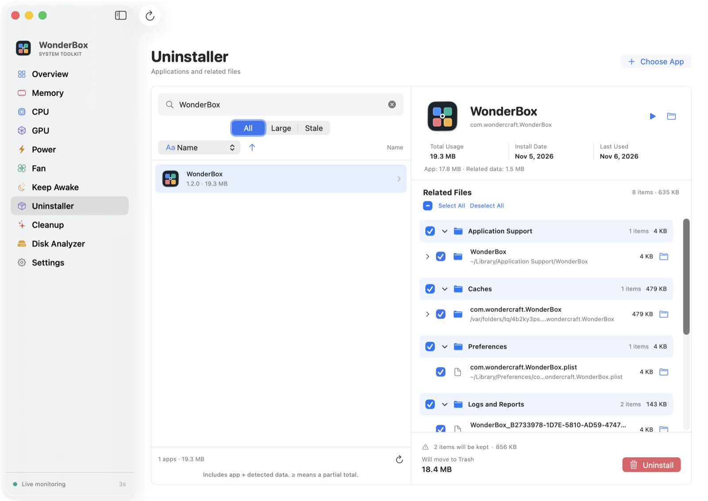

- Browse `/Applications` and `~/Applications`; search, filter large/unused apps and sort. Total footprint includes **the app bundle + discovered related data**, including unchecked items.
- Related files are grouped by purpose with folder previews, group selection and **Select All / Deselect All**. Unchecked files stay put; confirmation reports what will be retained.
- Discovery uses bundle/component identifiers, exact product names, container metadata, application-group declarations and bounded Electron metadata. Shared groups, migration folders, recovery data and ambiguous/shared components require review and default unchecked. macOS shared data and symlink traversal are excluded. See the [coverage matrix](docs/RELATED_FILES.md).
- Results appear before background sizing finishes. Small, cancellable budgets keep large directories responsive; `≥` means a lower bound. **Calculate Full Size** measures only the selected app and can be stopped. Lists/details share a short-lived cache; refresh invalidates it.
- Selected files move to the **Trash**: ordinary user permissions first, then Finder for eligible failures. No uninstall daemon or stored password. Errors preserve failed items for retry, distinguish Full Disk Access from Finder Automation, and report the actual system result.
- Quit the app before uninstalling. After removal, WonderBox checks selected paths and rescans; new leftovers are not silently selected. Selecting an app already in the Trash reviews related files without moving its bundle again.

### Optional background features

| Feature | Default | When it runs | What it does |
| --- | --- | --- | --- |
| Uninstall watcher plugin | Not installed until accepted | While logged in, even after WonderBox quits | Detects app removal and opens a related-file review; **never deletes without confirmation** |
| Automatic cleanup | Off | Checks every 5 minutes while WonderBox runs, including menu-bar-only use | Cleans only identified idle apps' rebuildable caches when your threshold/interval is met |
| Launch at login | Off | At login, if enabled separately | Starts WonderBox; distinct from the watcher plugin |

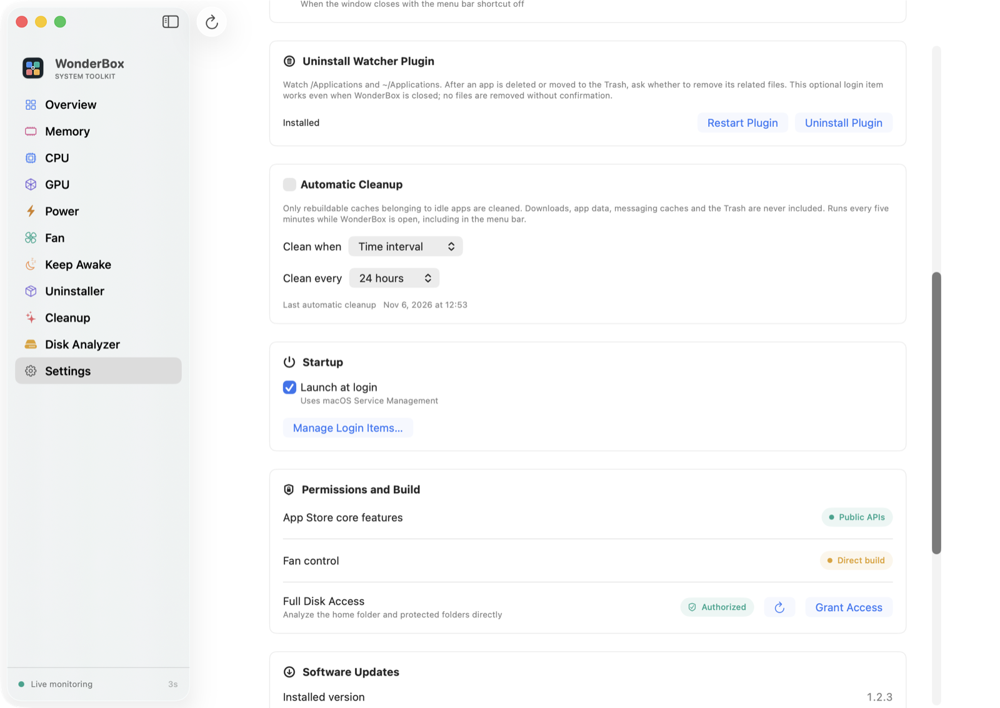

Configure the watcher and automatic cleanup in **Settings**; Cleanup also has **Automatic Cleanup Settings**. Choose a cache threshold from **128 MB–100 GB**, an interval from **1 hour–30 days**, or either condition. Unattended cleanup excludes unknown owners, running apps, symlinks, messaging/system caches, downloads, backups, app data and the Trash. Disabling it stops subsequent items after the current filesystem operation finishes; quitting pauses checks.

The watcher handles ordinary app updates, renames, moves and duplicate installs; removal evidence is rechecked before cleanup. Permission failures are not treated as uninstalls. macOS may ask you to approve it in **General → Login Items & Extensions**. After updating WonderBox, use **Restart Plugin** to load the new bundled watcher while preserving pending reviews. It requires a packaged `.app`, not `swift run`.

### Disk analysis and consistent refresh

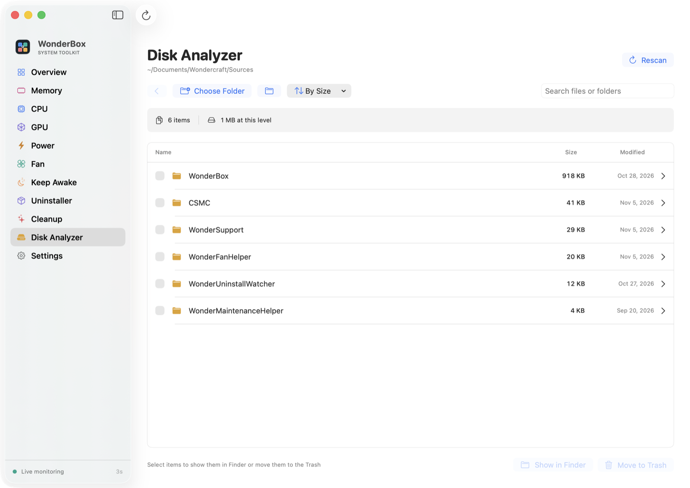

Browse folders, sort by size/name/date, reveal items in Finder or move selections to the Trash. File lists appear first; up to four cancellable background tasks fill in folder sizes. Revisits use a 60-second cache; **Rescan** forces fresh results. Cloud-sync directories are excluded from recursive sizing to avoid triggering downloads.

The toolbar refresh button and **⌘R** refresh the **current page**: processor/memory metrics and rankings, uninstall inventory and related files, cleanup scan, current disk folder, or settings status. Refresh does not clean files, optimize memory, change fan mode or extend keep awake.

### Settings, updates and diagnostics

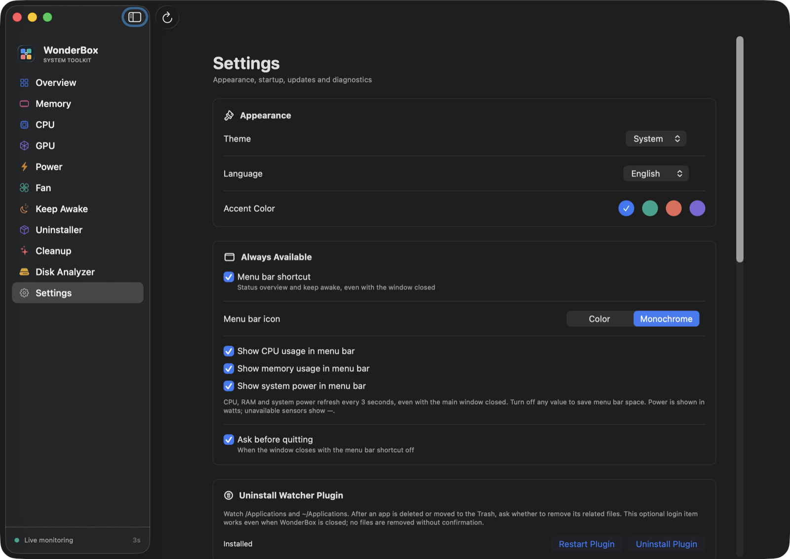

- Follow system/light/dark appearance, choose one of four accents and switch English/简体中文 (relaunch required). Configure menu-bar labels, close-window behavior, startup and permissions independently.
- **Software Update** or **WonderBox → Check for Updates…** checks GitHub stable releases. Automatic checking is on by default, at most once per 24 hours including failed attempts. Downloads support progress/cancel/retry and verify size and SHA-256 before saving. Archives retain quarantine metadata and are **not automatically installed or run**; quit, unzip and replace the app manually.
- **Diagnostics** records local operation results and numeric error codes, not filenames, paths, usernames, file contents, commands, tokens or high-frequency monitoring data. Up to four 512 KiB files, 2 MiB total, with a 7-day retention limit. Disabling logging clears local logs.
- **Export Logs…** creates a ZIP containing logs and basic app/macOS/architecture information; review it before sharing. No automatic upload. **Clear Logs…** does not delete ZIPs you previously exported.

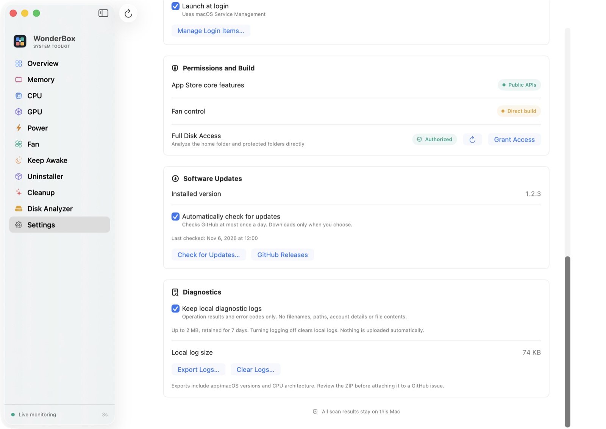

## Installation

Requires **macOS 14 or later**, Apple Silicon or Intel. Download the ZIP from [Releases](https://github.com/jasonwong1991/WonderBox/releases/latest), unzip and move `WonderBox.app` to Applications.

Current downloads are **ad-hoc signed and not Apple-notarized**. macOS may block first launch. After checking that you downloaded this project's release, use **System Settings → Privacy & Security → Open Anyway** if offered. The command below removes quarantine from that app only; it does not verify the publisher:

```bash
xattr -dr com.apple.quarantine /Applications/WonderBox.app
```

When upgrading, quit the old app before replacing it. If the watcher is installed, click **Restart Plugin** afterwards. Do not overwrite a running app.

### Permissions, only when needed

| Feature | Access |
| --- | --- |
| Basic monitoring, keep awake, app inventory | No administrator authorization |
| Broad home/protected-folder scans | Optional Full Disk Access for the app copy you actually run |
| Trash sizing/emptying and eligible protected-file removal | Finder Automation; Finder may request system authentication |
| Fan writes and memory optimization | Administrator authorization to install/update the fixed-command helper |
| Selected system-cache cleanup | Per-run administrator authorization |
| Optional watcher / launch at login | macOS Service Management; login-item approval may be required |

Root privileges do not replace privacy permissions. Uninstall does not install the helper. The helper validates the client's signing identity and user ID and accepts fixed operations, not arbitrary shell commands.

## Build and test

Use Xcode's macOS SDK and Swift 6:

```bash
git clone https://github.com/jasonwong1991/WonderBox.git
cd WonderBox
swift test
python3 -m unittest discover -s Tests/Packaging
python3 scripts/sync_localization.py --check
./scripts/package_app.sh
open build/WonderBox.app
```

`package_app.sh` builds a locally signed app with compiled string catalogs, generated icons, maintenance helpers and the embedded watcher. Set `UNIVERSAL=1` for Apple Silicon + Intel binaries. `swift run` is useful for development but does not create a registrable watcher bundle or compile the string catalogs into app resources. Packaging does not publish a release.

The current release profile is **direct distribution**. App Store distribution requires excluding private sensor/helper implementations and restricting file operations to sandbox grants; the presence of an entitlements file does not make the current bundle Store-ready. See [distribution, API boundaries and hardware acceptance](docs/DISTRIBUTION.md).

### Localization and contributing

Strings live in `Sources/WonderBox/Resources/Localizable.xcstrings` and `InfoPlist.xcstrings`. To add a language, translate both catalogs, add its code to `LANGUAGES` in `scripts/sync_localization.py` and `AppLanguage` in `Sources/WonderBox/Core/Localization.swift`, then run localization checks and tests. Running the sync script without `--check` extracts source strings and updates the key list.

Bug reports should include app/macOS version, Mac model, expected/actual behavior and steps to reproduce. For sensor issues, distinguish unavailable (`—`) from measured zero. Attach diagnostics only after reviewing the export. Community: [LinuxDo](https://linux.do).

## License and credits

[MIT](LICENSE) · [Third-party notices](THIRD_PARTY_NOTICES.md). WonderBox's app/menu-bar artwork is generated in this repository; it does not embed third-party logos. SF Symbols are native macOS UI symbols. App icons visible in screenshots belong to their respective owners.
