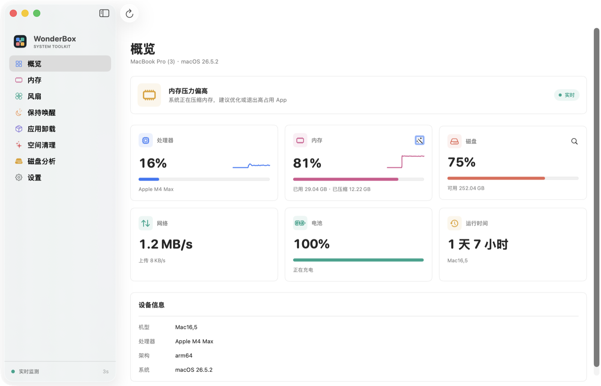
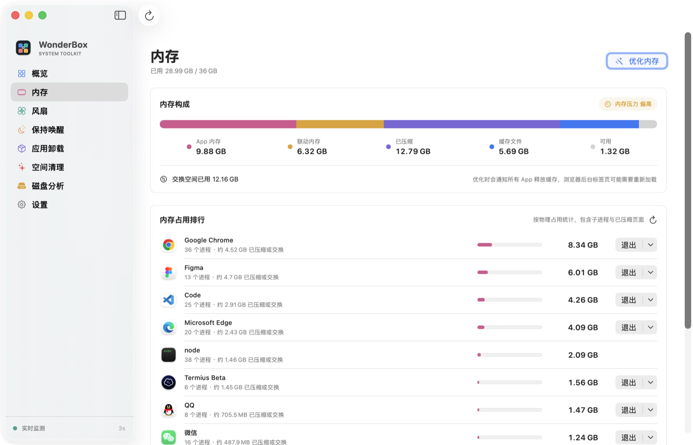
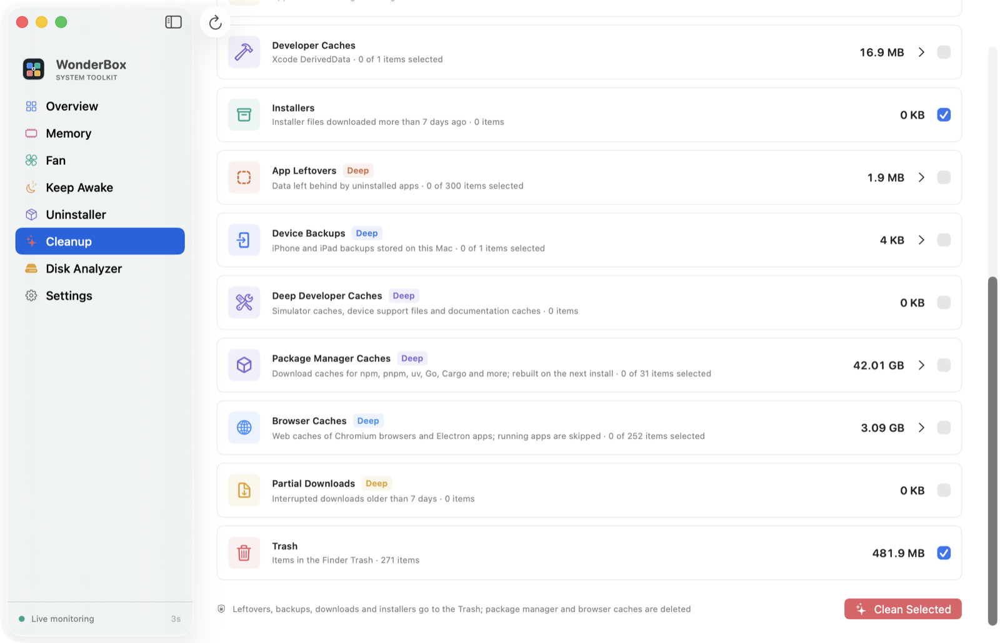
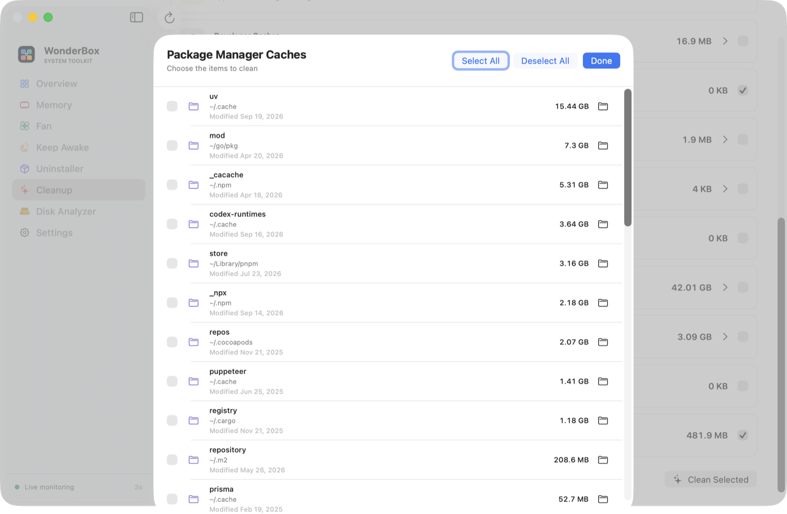
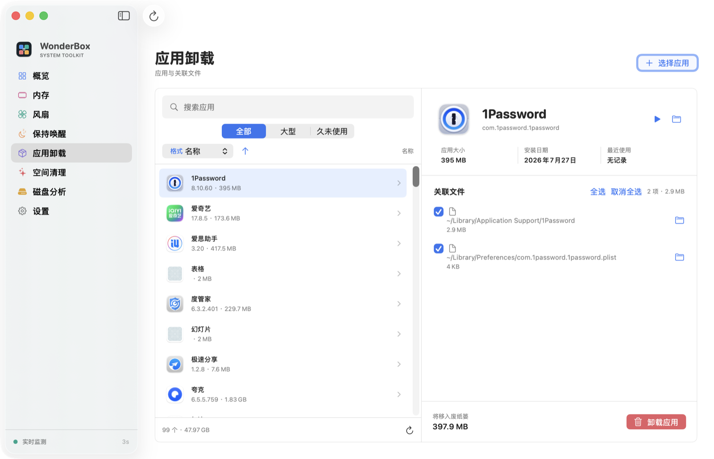
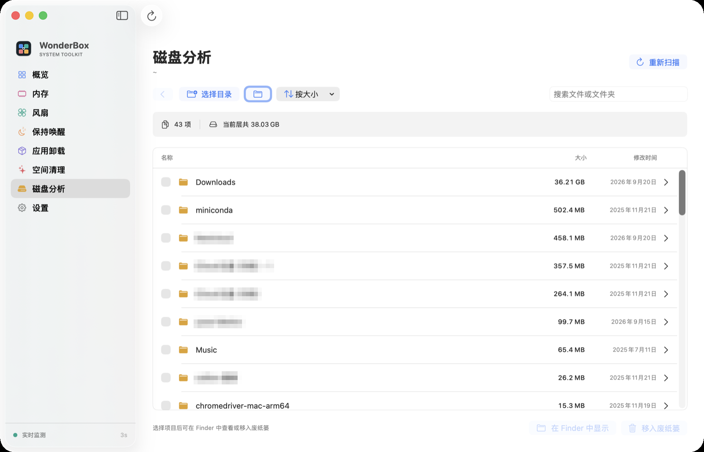
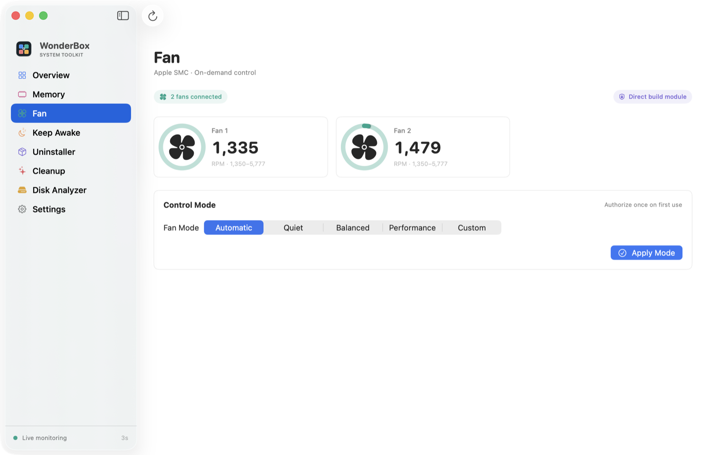
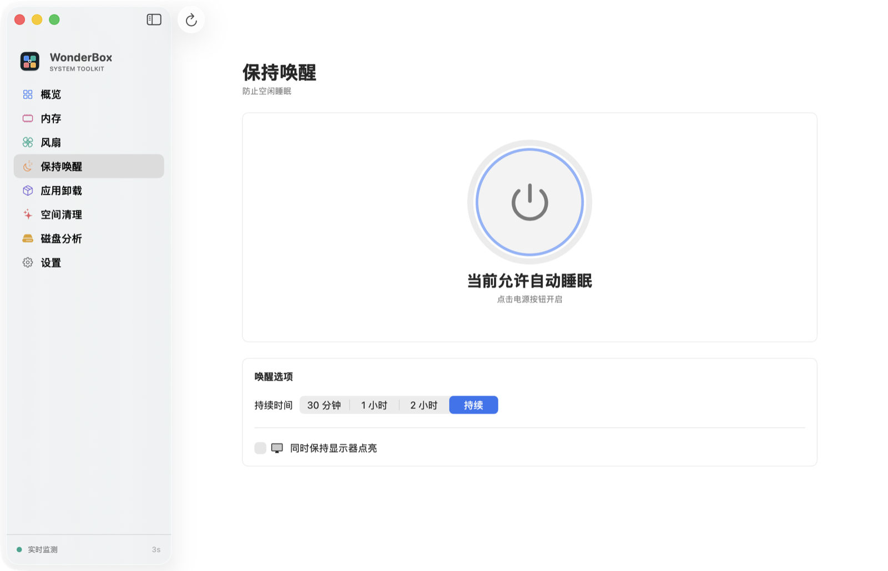
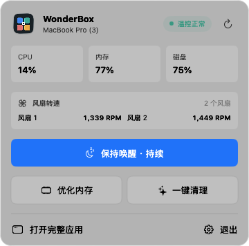
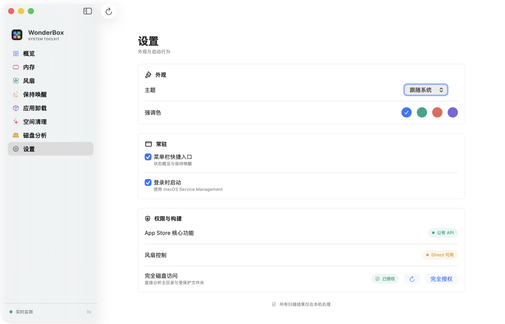

<p align="center">
  
</p>

<h1 align="center">WonderBox</h1>

<p align="center">
  A native macOS system toolkit that tells you the truth about your Mac.<br>
  Memory that actually shrinks, cleanup that finds the real space hogs, and numbers you can verify in Activity Monitor.
</p>

<p align="center">
  
  
  
  
  
</p>

<p align="center">
  English · <a href="README.zh-CN.md">简体中文</a>
</p>

## 1.0 Stable Release

Current version: **1.0.1**, build **101**. [Download](https://github.com/jasonwong1991/WonderBox/releases/tag/v1.0.1) · [Release notes](docs/releases/v1.0.1.md).

- **Core temperatures:** the Fan page shows CPU/GPU temperature summaries and individual available sensors. Recognized Intel core keys get core numbers; Apple Silicon and unknown mappings retain their sensor keys. Missing physical cores are never filled with estimated or duplicate temperatures.
- **Optional uninstall watcher:** offered on first launch and installable/removable in Settings. A separate macOS login item watches `/Applications` and `~/Applications`, even after WonderBox quits. Deleting an app or moving it to the Trash in Finder opens a related-file review; files only move to the Trash after explicit confirmation.
- **Compact window:** the menu-bar/Dock shortcut panel shows CPU/GPU temperatures and the estimated reclaimable amount for the existing default Quick Clean categories, refreshed after cleanup. Actual reclaimed space can differ.
- **Automatic cleanup:** off by default, with a first-visit prompt on the Cleanup page. Choose a cache threshold (128 MB–100 GB), an interval (1 hour–30 days), or either condition. Configure or disable it from Cleanup or Settings.

### 1.0.1 uninstall fixes

- Both uninstall interfaces have Select All / Deselect All. Discovery appears before background size measurement; late size results preserve selection. Confirmation no longer repeats the full related-file scan.
- The application list no longer walks every bundle before displaying it. After uninstall, only the affected application is updated instead of rescanning the complete inventory.
- Both interfaces now try WonderBox's own Trash API before Finder. Cookie permission denials lead to Full Disk Access guidance, not repeated administrator prompts. Unreadable directories no longer produce guessed Cookie filenames.
- **After updating, click Restart Plugin in Settings** to replace the already-running watcher. Pending reviews are preserved.

### Background behavior and cleanup scope

The watcher uses recursive FSEvents notifications, with a 30-second fallback check. A bookmark confirmed in Trash is queued immediately instead of waiting 30 seconds; unconfirmed path disappearance retains an eight-second app-replacement grace period. It accounts for ordinary app replacement, rename and duplicate-install cases, and uses bookmarks to distinguish relocation from Trash. Directory read failures are not evidence of removal. It neither deletes files nor requests administrator access; the main app rechecks whether the removed app is running, restored or reinstalled before cleanup. macOS may require approval in **System Settings → General → Login Items & Extensions**. Watching runs while the user is logged in. Permanently deleted bundles may lack component metadata; the review reports incomplete coverage.

Automatic cleanup checks every five minutes **while WonderBox is running**, including when only the menu bar remains. Quitting pauses it; reopening resumes checks with the saved settings. Enable **Launch at login** separately for automatic startup. Unattended cleanup includes only identified idle apps' rebuildable caches. Unknown owners, symlinks, messaging caches, system caches, downloads, backups, application data and the Trash are excluded. Cleanup operations are serialized and running apps are rechecked between cache items. Turning it off stops subsequent items after the current filesystem operation finishes.

The watcher requires the complete `.app` from `./scripts/package_app.sh`; `swift run` does not embed a registrable login item. Published downloads remain ad-hoc signed and are not notarized; see [Distribution](docs/DISTRIBUTION.md).



> The interface supports English and Simplified Chinese. Scans and diagnostic logs stay on-device. Update checks contact GitHub; logs are shared only if you export and send them yourself.

## Why WonderBox

Most "Mac cleaners" show you a big green number and hope you don't check. WonderBox is built the other way around:

- **Memory optimization that works on compressed memory.** `purge` only drops file cache, so tools that rely on it leave the "Compressed" figure untouched. WonderBox's root helper issues the same kernel memory-pressure broadcast macOS uses, so every running app trims its caches — and the compressed pages behind them are freed too. Then it reports the before/after per category and names the apps that responded.
- **Per-app memory you can act on.** Helper processes are rolled up into their host app (Chrome's 40 renderers show as one line), with an estimate of how much of each app is sitting in the compressor or swap. Quit or force-quit from the same row.
- **Cleanup that finds the tens of gigabytes, not the megabytes.** Package-manager caches, Chromium/Electron web caches, sandboxed container caches, simulator and DeviceSupport files — the places that actually fill a developer's disk.
- **Honest numbers.** Lower bounds are shown as `≥` when a size estimate times out. Results say what changed, or say plainly that nothing did.
- **Safety by construction.** Every deletion is checked against a per-category whitelist of roots and path shapes. User data (chat databases, documents, Docker VMs, toolchains) is never a candidate. Anything that isn't a rebuildable cache goes to the Trash.

## Features

### Memory



- Activity Monitor's categories — App, Wired, Compressed, Cached Files, Available — plus swap usage and the kernel's pressure level
- Per-app physical footprint ranking with the compressed/swapped share of each app, and graceful or force quit
- One-click optimization: system-wide memory-pressure broadcast, then file-cache purge, with a per-category before/after report
- The overview health banner reflects memory pressure, not just thermal state

### CPU and GPU

- Full-width usage charts show a rolling 60-second window with time/percentage axes. Missing GPU readings and sampling gaps are not drawn as idle time.
- Live per-application rankings, including helper processes, refreshed every 3 seconds; search, quit and force quit from the list
- CPU follows Activity Monitor's convention: one occupied core is 100%, so multi-core apps can exceed 100%
- GPU process usage comes from driver-provided context counters where available; unsupported drivers show `—`, not a fabricated zero. Concurrent contexts can total more than the overall device utilization
- Uptime includes sleep, matching System Information's “Time since boot”

### Space cleanup



**Standard scan** — user caches (including sandboxed app containers), logs, Xcode DerivedData, installers older than 7 days, Trash.

**Deep scan** adds:

| Category | What it covers |
| --- | --- |
| Package-manager caches | npm, pnpm, yarn, bun, uv and other `~/.cache` tools, Cargo registry, Go modules, Gradle, Maven, CocoaPods — download caches only; toolchains and installed versions are never touched |
| Browser & Electron caches | Chromium `Cache`, `Code Cache`, `GPUCache`, Service Worker `CacheStorage` and friends inside any profile or Electron user-data folder; skipped while the owning app is running |
| Developer deep caches | Simulator caches, iOS/watchOS/tvOS DeviceSupport, documentation cache, Previews devices |
| Application leftovers | Data left behind by apps that are no longer installed (90-day cutoff, bundle-id heuristics) |
| Device backups, partial downloads | Local iPhone/iPad backups; `.download`/`.crdownload`/`.part` files older than 7 days |

Every category expands to item level so you can keep one tool's cache and drop another:

App-cache details show application names, icons and combined cache sizes; expand an app to select individual folders. Search narrows the app list, and Select All / Deselect All applies to visible results. Done saves changes; Close or Escape keeps the previous selection. ZIP archives count as installers only when they contain an app, installer package or disk image.

Click **Name** or **Size** in cleanup details to sort application groups and their expanded cache folders. Size starts largest-first; click again to reverse. Selection and expanded groups are preserved, and unknown sizes stay last.

**WeChat and WeCom caches** have separate opt-in categories in standard and deep scans. Only explicit application/web cache directories are listed, not chat databases or downloaded attachments; caches go to the Trash, and running apps must be quit before cleanup. Background helpers and apps started after confirmation are checked again before moving each cache. Supported layouts include regular caches, sandbox/group containers, WebKit/Qt profiles and known legacy account/version cache folders.



### Application uninstall



Inventory of `/Applications` and `~/Applications` with size, install date and last-use date from Spotlight; large/stale filters; related caches, preferences, containers and saved state listed per app; everything goes to the Trash.

Related files are grouped in expandable folders with group selection and content previews. Normal user permissions are tried first; failed items are retried together through Finder's Move to Trash command (Apple Events). Finder handles any necessary authentication; WonderBox does not install or authorize its background service for uninstalling and never stores passwords.

Discovery also covers per-app recent-document records, autosave folders, default XDG data leaves, exact product leaves in shared updater/crash caches, and external plugins with matching bundle identifiers. Recovery data, cross-platform data and plugins are opt-in. The detail and removal confirmation warn about unchecked items and their measured size; Review Selection preserves the choices without automatically selecting shared data. See the [coverage and research matrix](docs/RELATED_FILES.md) for evidence and exclusions.

Discovery uses bundle identifiers, original/localized product names and exactly named directories directly under `~/Library`, plus product-named logs and preferences. It also inspects embedded Helpers, XPC services, extensions and login-item bundles, reads application-group entitlements from the code signature, and recognizes launch plists whose executable points inside the selected app. Exact product-path probes one level below Application Support vendor folders find matching leaves without enumerating other apps' data or selecting the whole vendor directory. Shared groups, independently identified components, declared privileged helpers and vendor-subfolder matches show their association source and are unchecked by default for review. There is no per-app whitelist; a six-product fixture matrix tests different names, identifiers and storage layouts, alongside near-name/sibling/symlink negative cases.

For Electron apps, bounded reads of the root `package.json` (loose or ASAR-packed) recover the internal runtime product name. The declared bootstrap file is also checked for explicit sibling-directory migration references near a `userData` lookup; matching legacy product data in Application Support is listed with a review label and remains unchecked, as other editions may still use it. This is evidence-based, not an app-name prefix deletion rule. Dependencies, assets and source maps are not searched, JavaScript is never executed, and archives are not unpacked. Reads are capped at a 2 MiB archive index, 64 KiB package metadata and 1 MiB bootstrap; malformed offsets, links, path traversal and oversized files are ignored. These names remain available for verification after the app bundle is moved.

Shared macOS roots such as Mail, Messages and Keychains are excluded, and symbolic links are not followed. Discovery is based on identifiable evidence, not a guarantee of every arbitrary custom data path. The app list and size sorting show bundle plus discovered related data, including unchecked items; the detail shows the breakdown. The related-file list appears before recursive sizing finishes, and removal does not wait for size measurements. Automatic sizing uses one utility worker with a shared per-app budget of 60 ms / 1,500 entries, not a full walk of every large chat/cache directory. `≥` denotes a lower bound and unmeasured folders are labeled explicitly. **Calculate Full Sizes** starts a cancellable, throttled traversal of the selected app only; switching apps or tabs stops the old workers. Session-only caches reuse metadata and sizes across inventory/detail scans, expire after short intervals, and are cleared on refresh/removal. Batched UI updates, cached sorting/summaries and O(n log n) directory dedup avoid repeated expensive main-thread work. Shared and nested data roots are counted once in the list's combined total; selecting fewer files changes the removal amount, not the application's detected footprint.

Sandbox containers are found by bundle identifier and container metadata, including UUID-named containers. Unreadable locations produce an access warning rather than an empty-success result. Apps already in the Trash can be selected to remove only their related files. Uninstall checks that selected sources disappeared, rescans for remaining files, and keeps failures available for retry; newly discovered files are unchecked until reviewed. Quit the app before uninstalling to prevent it from recreating its data.

Uninstall reports the actual system error, retains failed items for retry and provides Details and Show Remaining Items in Finder actions. Cancelling the system operation does not trigger another authorization attempt. Finder Automation permission is requested only when needed; denial shows the Automation settings action, not a Full Disk Access warning.

### Disk analyzer

The toolbar refresh button and **⌘R** refresh the current tab, not just Overview. CPU/GPU and Memory refresh both system metrics and app rankings; Uninstaller rescans apps and selected-app related files; Cleanup rescans without cleaning; Disk Analyzer bypasses cached sizes for the current directory. Settings reloads permission/login-item status, log size and update availability. Refreshing never starts optimization, changes fan mode or extends a keep-awake session.



Drill into any folder level by level: metadata rows appear first, then four cancellable background workers fill in folder sizes. Navigation stays available while sizing; returning to a recently scanned folder uses a bounded 60-second cache, and Rescan forces a refresh. Incomplete totals are shown as lower bounds. Sort by size/name/date, reveal in Finder or move selected items to the Trash. Cloud-synced folders are excluded from automatic traversal.

### Fan control, keep awake, menu bar

<table>
  <tr>
    <td width="50%"></td>
    <td width="50%"></td>
  </tr>
</table>



- Live fan RPM from AppleSMC; quiet/balanced/performance/custom modes on Macs that expose writable fan control (Apple Silicon `Ftst` unlock included), always revertible to automatic
- Keep-awake with a 30 min / 1 h / 2 h / indefinite timer and optional display wake, using public IOKit assertions
- Menu bar dashboard: CPU, memory, disk, fan RPM, keep-awake toggle, memory optimization and one-click cleanup without opening the window
- Choose **Color** or **Monochrome** under **Settings → Always Available → Menu bar icon**. Color preserves the original icon (the default); monochrome follows the system menu bar appearance. Changes apply immediately and are remembered across launches.
- System / light / dark appearance, four accent colours, launch at login
- A dedicated Startup settings area with approval status and an entry point to macOS Login Items management; external changes are reflected when returning to WonderBox



### Updates and diagnostics

- **Settings → Software Updates**, or **WonderBox → Check for Updates…**: check GitHub's latest stable release, read release notes and choose where to download the ZIP. Automatic checks are enabled by default and throttled to once per 24 hours (including failed attempts); turn them off in Settings. If the REST API is rate-limited, the official latest-release redirect and `SHA256SUMS` provide a fallback. Checks send no scan results or diagnostics, use no account/token and store no cookies.
- Downloads show progress, support cancellation/retry, and require the expected size plus a SHA-256 digest from GitHub or the release's `SHA256SUMS`. Files are saved atomically after verification, retain macOS quarantine metadata and are never unpacked or executed automatically. Quit WonderBox, unzip the archive and replace the app manually. Direct builds only; App Store builds use the Store's update mechanism.
- **Settings → Diagnostics**: lightweight local operation results and numeric error codes help diagnose permissions, fan reads, cleanup and update failures. Logging is enabled by default; disabling it clears the logs. Four rotating files of at most 512 KiB each (2 MiB total) retain events for no longer than 7 days. No high-frequency monitoring samples, filenames, paths, usernames, account details, commands, tokens or file contents are logged. WonderBox's diagnostic directory is excluded from routine log cleanup.
- **Export Logs…** creates a ZIP of the bounded logs plus app/macOS versions and CPU architecture; it also works when logging is off. Review the ZIP and attach it to your issue yourself. No automatic upload, telemetry or crash-reporting service. **Clear Logs…** removes local logs, not previous exports.

## Install

Requirements: macOS 14 or newer, Apple Silicon or Intel.

**Download:** grab `WonderBox-x.y.z.zip` from the [latest release](https://github.com/jasonwong1991/WonderBox/releases/latest), unzip, and drag `WonderBox.app` to Applications.

The release build is signed ad hoc, not notarized, so the first launch is blocked by Gatekeeper. Either right-click the app → Open, then confirm in System Settings › Privacy & Security › "Open Anyway", or clear the quarantine flag once:

```bash
xattr -dr com.apple.quarantine /Applications/WonderBox.app
```

**Build from source** (Xcode 16 or newer):

```bash
git clone https://github.com/jasonwong1991/WonderBox.git
cd WonderBox
swift build
swift test
./scripts/package_app.sh
open build/WonderBox.app
```

The package builds `WonderBox`, two maintenance helpers and the optional uninstall watcher login item. `package_app.sh` produces a locally signed `build/WonderBox.app` with the generated icon, compiled string catalogs and bundled helpers; `UNIVERSAL=1 ./scripts/package_app.sh` builds the Apple Silicon + Intel binaries used for releases.

## Languages

WonderBox ships in English and Simplified Chinese and follows the system language; Settings › Language overrides it per app. Strings live in a single catalog, `Sources/WonderBox/Resources/Localizable.xcstrings`, with English as the source language.

To add a language:

1. Open `Localizable.xcstrings` (and `InfoPlist.xcstrings`) in Xcode's String Catalog editor, or edit the JSON directly, and add the new language code under each key's `localizations`.
2. Add the code to `LANGUAGES` in `scripts/sync_localization.py` and to the `AppLanguage` enum in `Sources/WonderBox/Core/Localization.swift` so it appears in the picker.
3. Run `scripts/sync_localization.py --check`; it fails on untranslated keys. `swift test` checks the same thing plus format-specifier consistency.

`scripts/sync_localization.py` (no flags) asks the compiler for every localizable string in source and adds new keys to the catalog, so you never hand-maintain the key list.

## Permissions

WonderBox asks for exactly what a feature needs, when you first use it:

| Feature | Permission | When |
| --- | --- | --- |
| Monitoring, keep awake, app inventory, standard cleanup | none | — |
| Trash size and emptying | Automation (Finder) | first cleanup scan |
| Full home-directory scans | Full Disk Access (optional, user-controlled) | onboarding or Settings |
| Fan control, memory optimization | Administrator authorization to install or update the shared helper | first privileged action |
| Protected app removal | macOS's Finder-style Trash operation; system authentication if needed | when normal removal fails |
| `/Library/Caches` cleanup | Administrator password per run | when that category is selected |

The helper daemon is a fixed-command service reachable over a root-owned Unix socket. It verifies the caller's signing identity and user ID before accepting fan, memory-maintenance or restricted Trash requests; it never executes caller-supplied shell commands. Installing or updating the helper, or changing the app's ad-hoc signing identity, requires administrator authorization.

## Distribution profiles

The core monitor and awake features use public APIs. Application and cleanup operations use public Foundation APIs, but broad user-Library access is restricted by App Sandbox.

- **Direct** (what `package_app.sh` builds): bundles `WonderFanHelper`; the helper daemon (protocol v6) performs fan writes and memory-pressure broadcast/purge. Uninstall uses the system Trash operation instead. Full Disk Access can be enabled for broad local scans.
- **App Store:** enable `WonderBox-AppStore.entitlements`, omit the fan helper/CSMC source, and retain user-selected file access. Broad cleanup categories must use folder selection with security-scoped bookmarks or be disabled.

See [`docs/DISTRIBUTION.md`](docs/DISTRIBUTION.md) for the capability matrix and release checklist.

## Brand asset provenance

The WonderBox app and menu bar icons are original geometric artwork generated entirely by `scripts/generate_icon.swift` and `MenuBarAppIcon` in this repository. They do not embed third-party logos, stock artwork, or copied image assets. SF Symbols are used only as native macOS interface symbols inside the app. Application icons visible in screenshots belong to their respective owners.

## Community

[LinuxDo](https://linux.do)

## License

[MIT](LICENSE)
