<p align="center">
  
</p>
<h1 align="center">WonderBox</h1>
<p align="center">
  原生 macOS 系统工具箱：监控、清理与日常维护。<br>
  看清 Mac 的运行状态，决定哪些文件留下，把常用控制放进菜单栏。
</p>
<p align="center">
  
  
  
  
  
</p>
<p align="center">
  <a href="README.md">English</a> · 简体中文<br>
  <a href="https://github.com/jasonwong1991/WonderBox/releases/latest">下载</a> ·
  <a href="#功能">功能</a> · <a href="#安装">安装</a> ·
  <a href="#构建与测试">构建与测试</a>
</p>

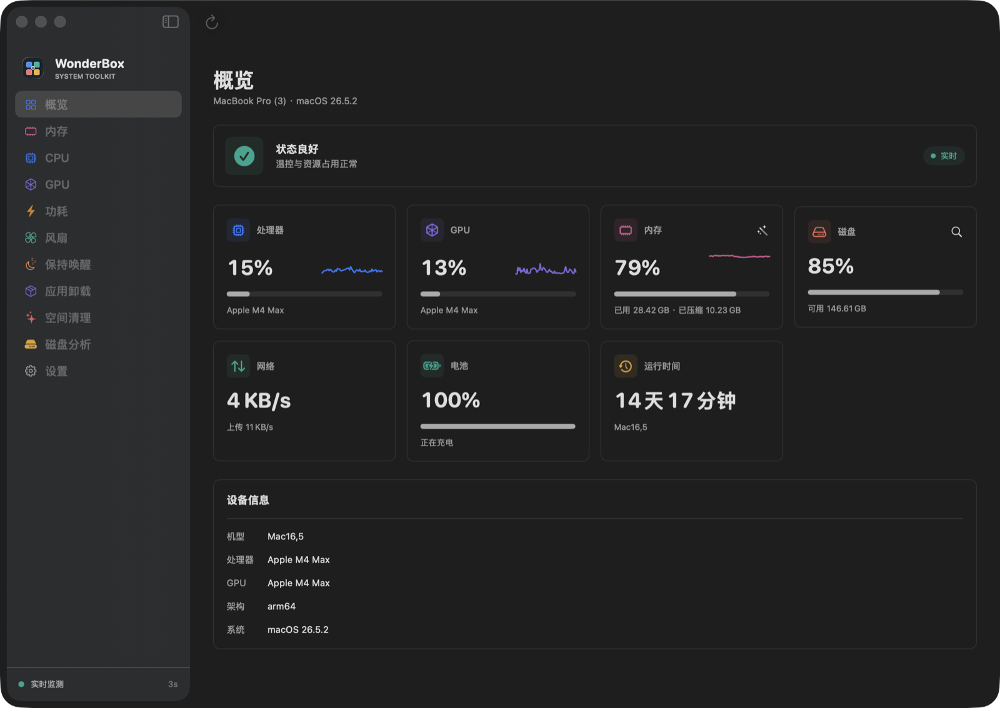

截图来自当前源码构建，展示一台 Mac 的实时数据与所选设置；数值和传感器支持因设备而异，并非所有开关的默认状态。见[截图维护说明](docs/SCREENSHOTS.md)。

## 一眼了解

| 实时监控 | 清理维护 | 按需开启 |
| --- | --- | --- |
| CPU/GPU 曲线与应用排行 | 内存优化及前后对比 | 菜单栏 CPU、内存与功耗数值 |
| 内存压力、压缩与交换空间 | 标准／深度清理、逐项选择 | 保持唤醒、登录时启动 |
| 系统／CPU／GPU 功耗历史 | 应用卸载与关联文件复查 | 卸载监测插件、自动清理 |
| 温度传感器与风扇转速 | 逐层浏览磁盘占用 | 中英文、浅色／深色、四种强调色 |

**发行版：**[1.2.3 · 构建 123](https://github.com/jasonwong1991/WonderBox/releases/tag/v1.2.3) · [更新说明](docs/releases/v1.2.3.md)。
**当前源码新增：**菜单栏显示**系统功耗**，默认关闭。需从源码构建体验；上方 1.2.3 下载包尚未包含这一新增功能。

扫描结果和诊断记录留在本机。更新检查会连接 GitHub；日志只有在你导出并主动发送时才会分享。没有账号、遥测或自动上传日志。

## 功能

### 菜单栏：CPU、内存与系统功耗

在 **设置 → 常驻** 中按需开启：

- **在菜单栏显示 CPU 占用**：整机 CPU 利用率，范围为 0–100%。
- **在菜单栏显示内存占用**：App 内存＋联动内存＋已压缩，占物理内存的比例。
- **在菜单栏显示系统功耗**：与功耗页的系统传感器同源，以瓦显示，例如 `PWR 18.3 W`。

<p></p>

三项**独立开关，默认全部关闭**。同时开启时显示如 `CPU 12% · RAM 64% · PWR 18.3 W`。切换立即生效，重启后保留；隐藏菜单栏快捷入口也不会清除选择。

数值约每 **3 秒**刷新一次，关闭主窗口后继续工作。只采集开启的项目；功耗仅读取 SMC **PSTR** 系统传感器，不启动 CPU/GPU 能量订阅、进程扫描或功耗历史采集。关闭全部数值或隐藏入口后停止采样。睡眠时清空读数，唤醒后重新采样。传感器不可用显示 `—`；CPU 在取得真实采样基线前也不会伪装成零。

图标支持**彩色／单色**，单色跟随系统菜单栏外观。点击图标打开紧凑面板：

<p align="center">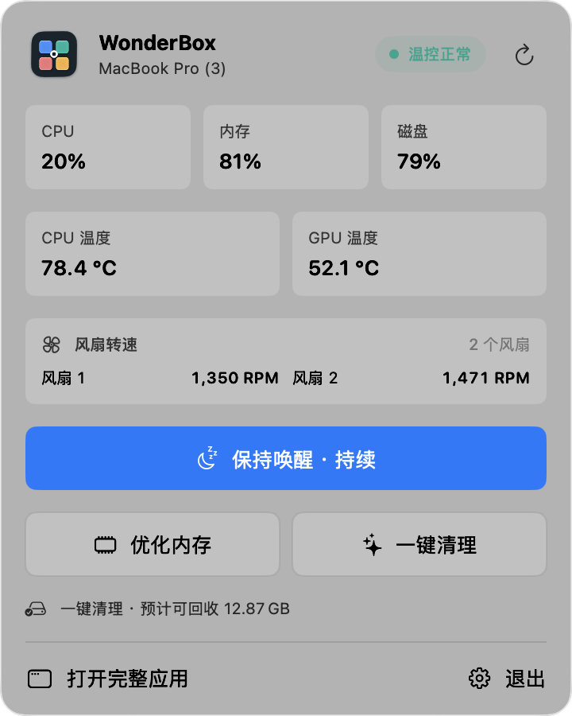</p>

面板包含 CPU／内存／磁盘占用、可用的 CPU/GPU 温度、风扇转速、保持唤醒、内存优化，以及带可清理空间估算的快速清理。清理后更新估算；实际释放空间可能不同。

### CPU、GPU 与内存

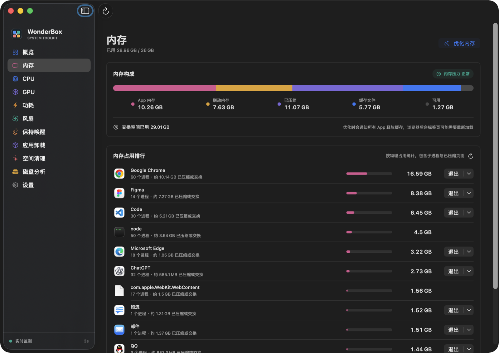

- **CPU/GPU：**最近 60 秒的滚动曲线，包含时间和百分比坐标；应用排行合并辅助进程，支持搜索、退出与强制退出。注意：在**应用排行**中，占满一个 CPU 核心为 100%，多核应用可超过 100%；GPU 上下文总计也不等于整机利用率。不支持的驱动显示 `—`。
- **内存：**App 内存、联动内存、已压缩、缓存文件、可用，以及交换空间与系统内存压力。按应用汇总物理占用，估算其中已压缩或交换的份额。
- **内存优化：**辅助服务请求系统级内存压力释放，再清理文件缓存；报告逐类别的前后变化及应用响应。释放量取决于当前负载，不承诺固定收益。
- **概览：**CPU、内存、磁盘、网络、可用时的电池状态，以及包含睡眠的运行时间。健康提示同时考虑内存压力，而不只是温控状态。

<table><tr>
  <td width="50%">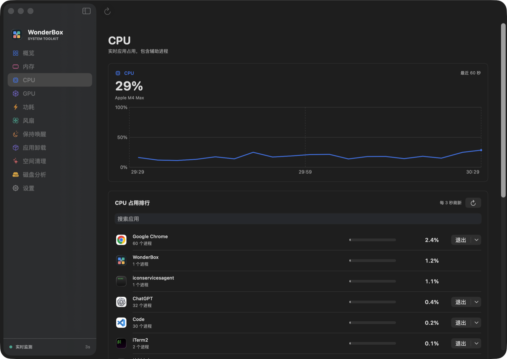</td>
  <td width="50%">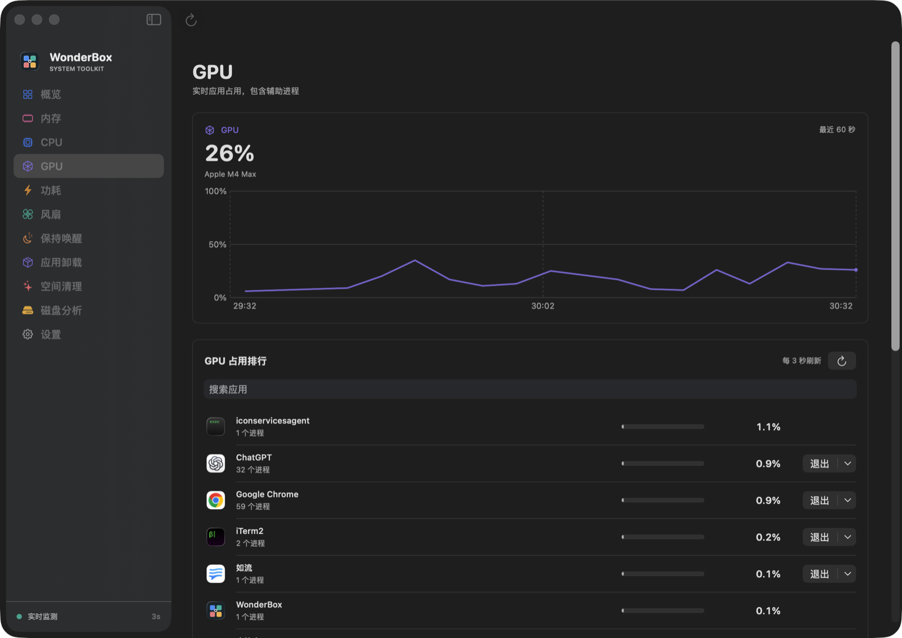</td>
</tr></table>

### 功耗与温度

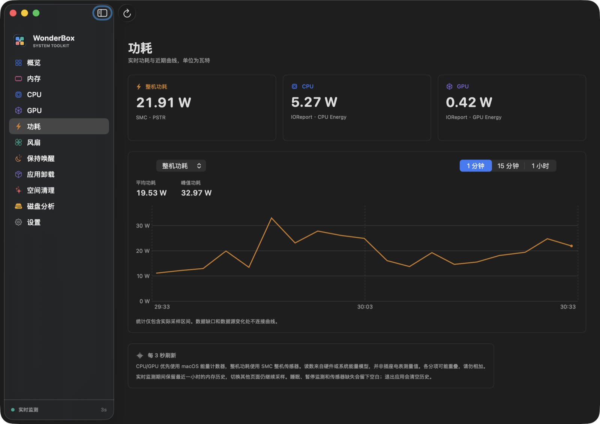

- **功耗页：**系统、CPU、GPU 的当前瓦数，以及 **1 分钟／15 分钟／1 小时**历史、有效采样区间的平均值与峰值。历史仅在实时监控运行时保存在内存；暂停和睡眠留下断点，退出后清空。菜单栏系统功耗独立采样，不会维持这份历史记录。
- **数据来源：**按真实采样间隔换算的 IOReport 能量计数，以及支持的 SMC 读数。系统功耗来自 PSTR，不把 CPU＋GPU、电池充电速率或适配器输入当作系统功耗。这些是硬件／模型读数，**不是插座功率计测量值**；部件范围可能重叠。CPU 封装回退读数会明确标注。
- **兼容性：**传感器可用性随 Mac 与 macOS 变化。缺失、无效、过期读数显示 `—`，真实零值保留。沙盒版本不读取这些私有接口。1.2.3 的 M6／macOS 27.2 路径按精确系统构建匹配，反馈用户的 M6 真机读数仍待验证，详见[兼容性说明](docs/DISTRIBUTION.md#m6--macos-272-cpu-energy-123)。
- **风扇页：**CPU/GPU 温度汇总、逐个可用传感器和实时 RPM。已识别的 Intel 传感器标注核心编号，其他传感器保留键名；不补造缺失核心，也不从转速猜测风扇瓦数。

<table><tr>
  <td width="50%">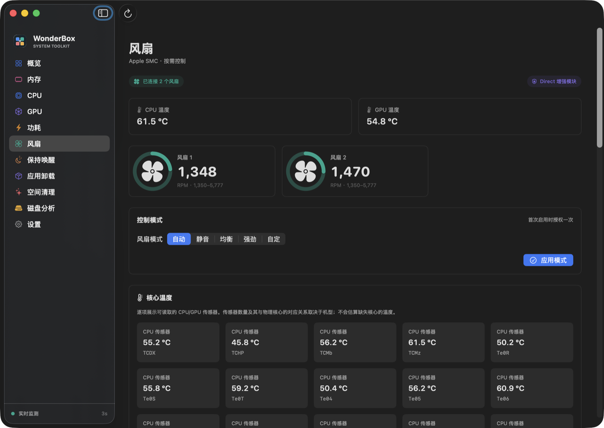</td>
  <td width="50%">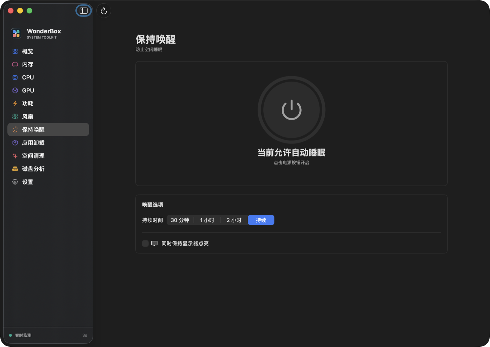</td>
</tr></table>

**硬件允许写入时**，风扇支持自动、静音、均衡、强劲和自定模式；仅打开页面不会授权服务或切换模式。保持唤醒使用 IOKit 断言，支持 30 分钟／1 小时／2 小时／持续，并可选择同时保持显示器点亮。

### 空间清理，逐项确认

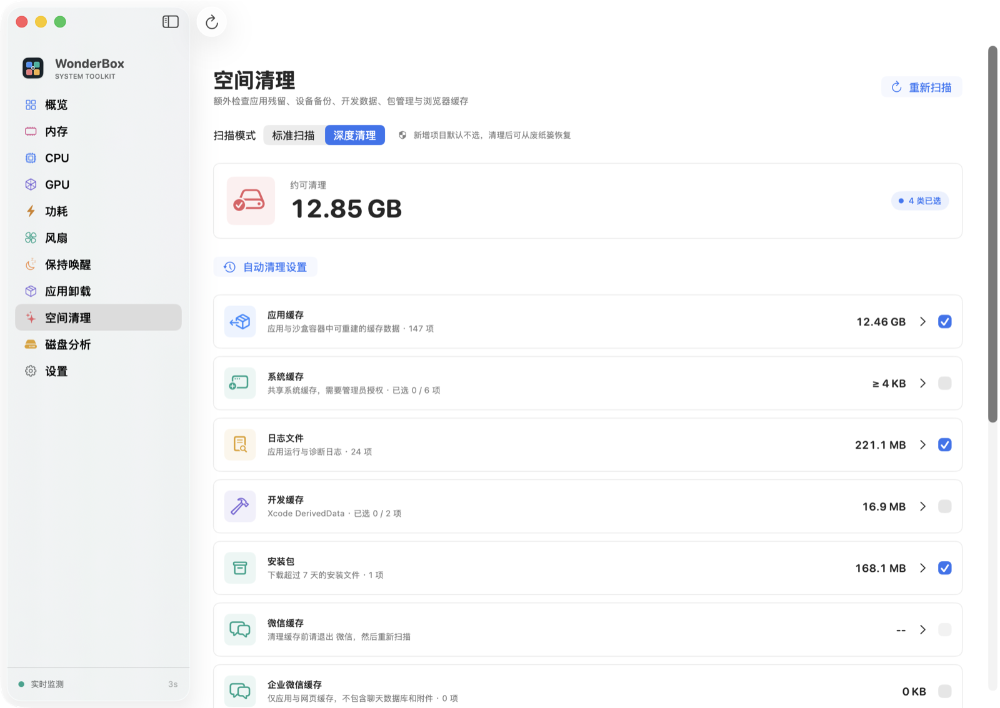

| 扫描 | 范围 |
| --- | --- |
| 标准扫描 | 用户及沙盒容器缓存、日志、Xcode DerivedData、超过 7 天的安装包、废纸篓 |
| 深度扫描新增 | 包管理缓存、Chromium/Electron 缓存、模拟器与 DeviceSupport、疑似应用残留、本机设备备份、未完成下载 |
| 单独选择，默认不勾选 | 微信、企业微信的应用／网页缓存，不含聊天数据库与下载附件 |

包管理器覆盖 npm、pnpm、yarn、bun、uv、Cargo、Go、Gradle、Maven、CocoaPods 的下载缓存，不清理已安装运行时、工具链或 Docker 虚拟磁盘。ZIP 只有包含实际安装内容或标准应用包元数据时才算安装包，不因父目录名称像安装包就归类。

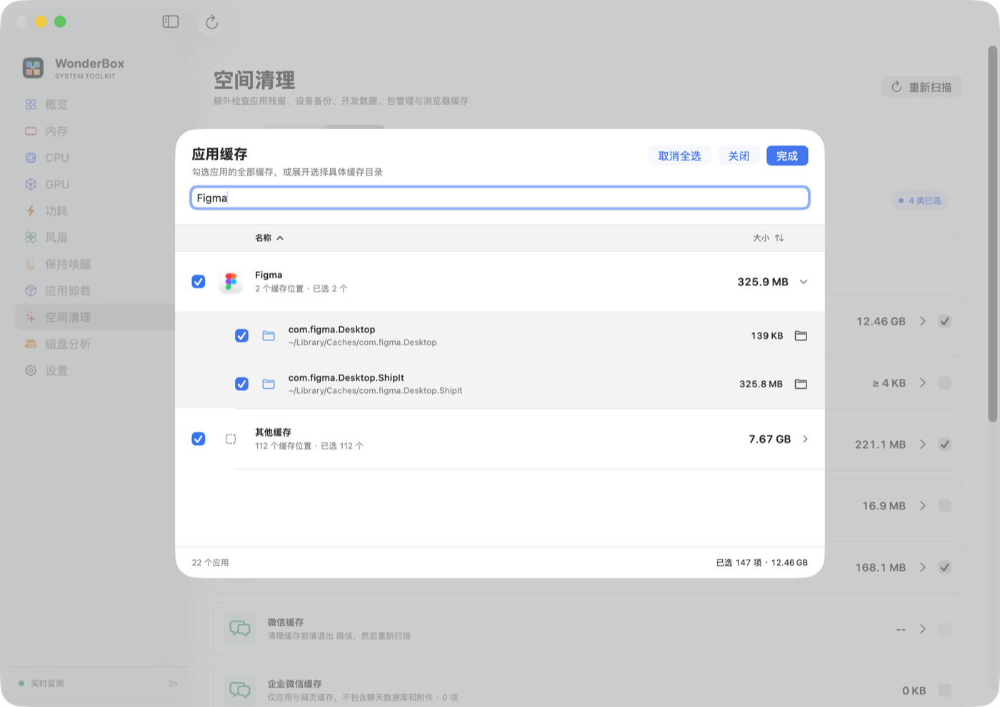

展开类别选择具体项目。应用缓存按名称和图标分组；搜索后的**全选／取消全选**只作用于可见结果。点击**名称／大小**排序，保留勾选和展开状态。**完成**保存草稿，**关闭／Escape**放弃草稿。未完成的大小统计标注 `≥`，未知大小不冒充零。

执行时按类别重新校验根目录及路径形状。运行中的浏览器／Electron 应用会跳过；通讯应用缓存需退出对应应用，且移入废纸篓。清理前请检查选项：可重建缓存可能直接删除，清空废纸篓也不可撤销。

### 应用卸载与关联文件

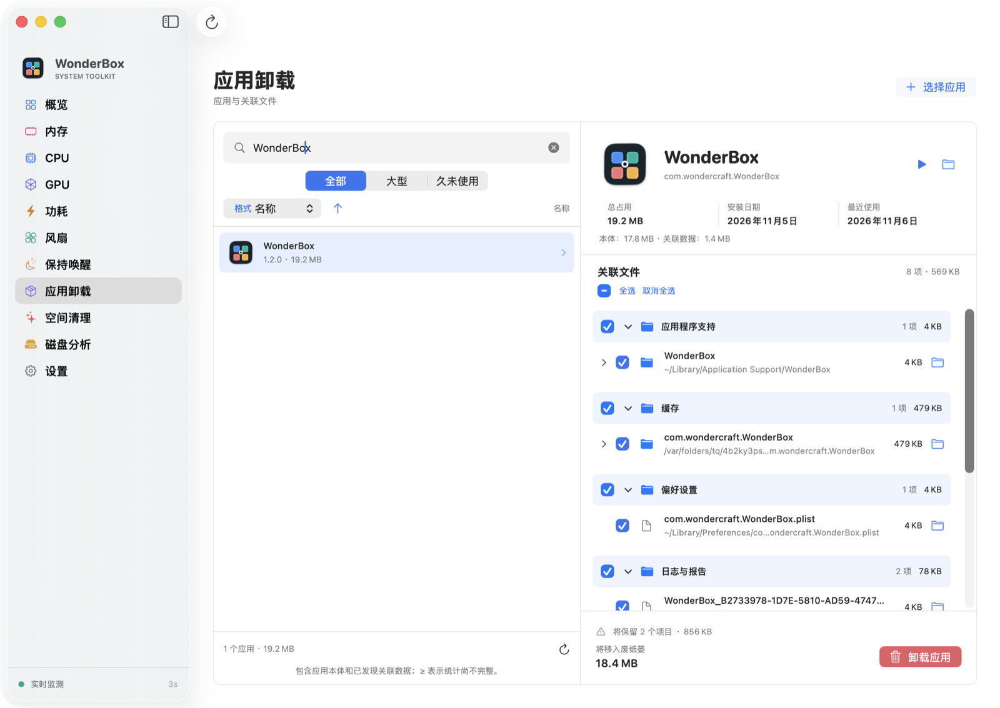

- 盘点 `/Applications` 和 `~/Applications`，支持搜索、大型／久未使用筛选与排序。总占用包含**应用本体＋已发现关联数据**，包括未勾选项目。
- 关联文件按用途分组，支持文件夹预览、分组勾选和**全选／取消全选**。未勾选文件保留原位，确认时会提示保留的数量和大小。
- 依据应用及组件标识符、精确产品名称、容器元数据、应用组声明和有限读取的 Electron 元数据发现关联项。共享组、旧版迁移目录、恢复数据及归属需确认的组件默认不勾选；排除系统共用数据，不沿符号链接扫描。详见[关联文件覆盖矩阵](docs/RELATED_FILES.md)。
- 先显示发现结果，再后台统计大小。有限、可取消的统计预算避免大目录阻塞界面；`≥` 表示下界。**计算完整大小**只针对当前应用，支持停止。列表与详情共享短期缓存，刷新后失效。
- 选中项目**移入废纸篓**：先用普通用户权限，再对适用的失败项目调用 Finder；卸载不安装辅助服务，也不保存密码。失败项保留重试，区分完全磁盘访问与 Finder 自动化权限，显示系统实际错误。
- 卸载前需退出应用。完成后复核所选路径并重扫，新发现残留不自动勾选。选择已在废纸篓内的应用时，只复查关联文件，不重复移动应用本体。

### 按需开启的后台功能

| 功能 | 默认 | 运行时机 | 行为 |
| --- | --- | --- | --- |
| 卸载监测插件 | 接受安装前不安装 | 用户已登录时，即使 WonderBox 已退出 | 发现应用移除后打开关联文件复查，**未经确认不删除文件** |
| 自动清理 | 关闭 | WonderBox 运行期间每 5 分钟检查，包括仅菜单栏运行 | 达到设定阈值／间隔时，仅清理归属明确且未运行应用的可重建缓存 |
| 登录时启动 | 关闭 | 单独开启后，在登录时 | 启动 WonderBox，与卸载监测插件独立 |

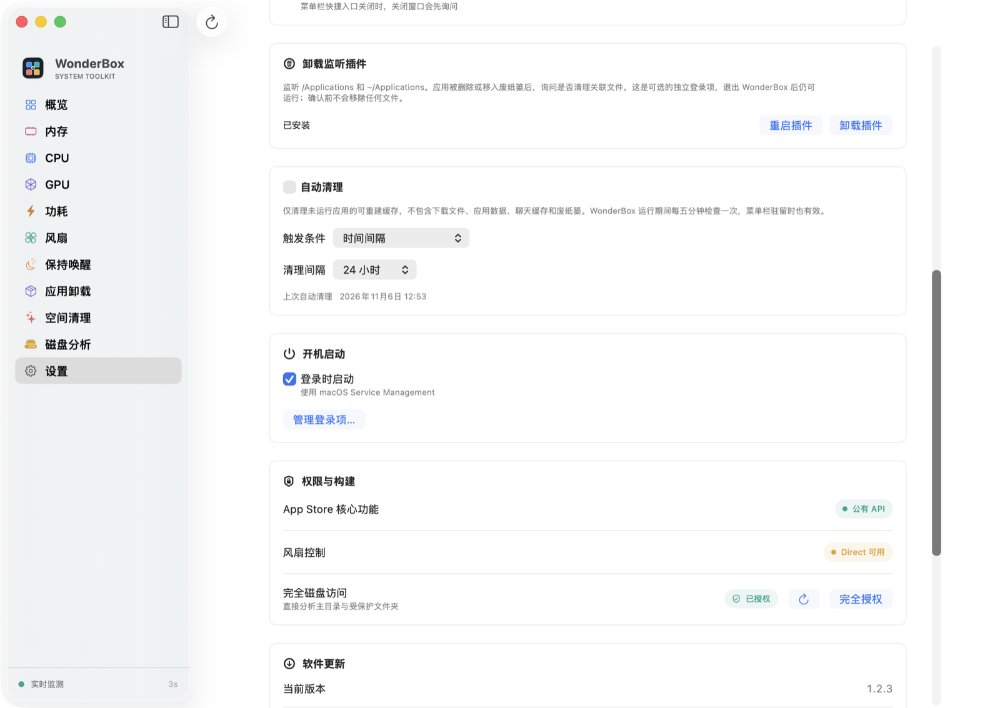

在**设置**中管理插件与自动清理；清理页也有**自动清理设置**入口。缓存阈值支持 **128 MB–100 GB**，间隔支持 **1 小时–30 天**，可选择满足任一条件。无人值守清理排除未知归属、运行中应用、符号链接、通讯／系统缓存、下载、备份、应用数据与废纸篓。关闭后，当前文件操作完成即停止后续项目；退出应用暂停检查。

插件会区分普通应用更新、重命名、移动和重复安装，清理前再次检查移除证据；读取权限失败不会当作卸载。macOS 可能要求在**通用 → 登录项与扩展**中批准。更新 WonderBox 后请点击**重启插件**，加载新版内嵌插件并保留待处理复查。插件需要完整 `.app`，不适用于 `swift run`。

### 磁盘分析与统一刷新

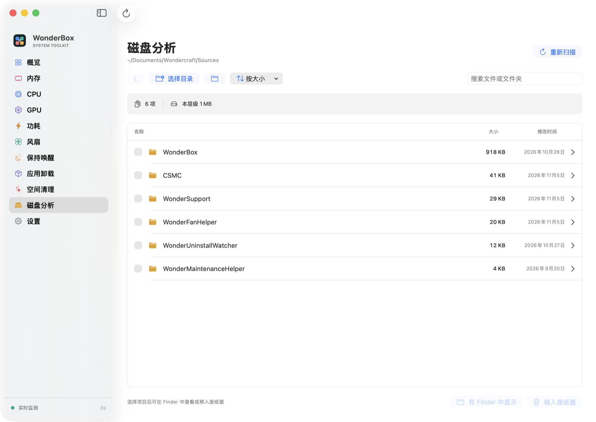

逐层浏览目录，按大小／名称／日期排序，在 Finder 中显示或将所选项目移入废纸篓。先显示文件列表，再由最多四个可取消任务补充文件夹大小。返回目录可复用 60 秒缓存，**重新扫描**强制刷新。云同步目录不参与递归体积统计，避免触发下载。

工具栏刷新按钮与 **⌘R** 刷新**当前页面**：CPU/GPU 与内存指标和排行、卸载列表与关联项、清理扫描、当前磁盘目录或设置状态。刷新不会清理文件、优化内存、调整风扇模式或延长唤醒时间。

### 设置、更新与诊断

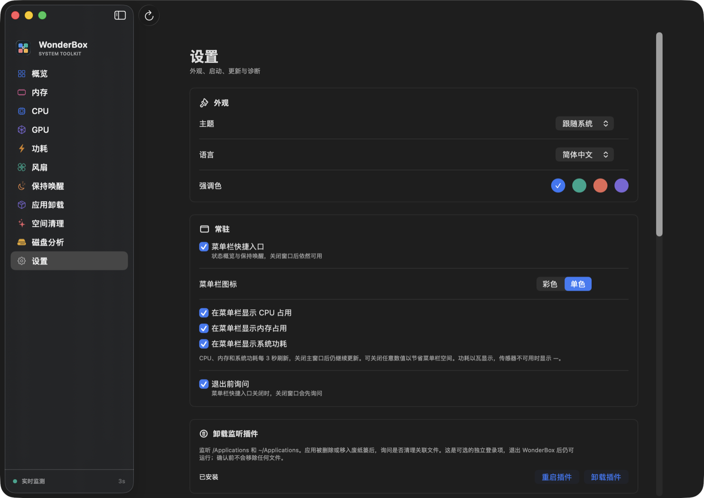

- 支持跟随系统／浅色／深色、四种强调色、中英文切换（需重启）。菜单栏数值、关闭窗口行为、登录启动与权限分开配置。
- **软件更新**或菜单 **WonderBox → 检查更新…** 检查 GitHub 正式版。自动检查默认开启，每 24 小时最多一次尝试，失败也计入。下载支持进度、取消与重试，保存前校验体积与 SHA-256，保留隔离标记，**不自动安装或运行**；需退出后手动解压替换。
- **诊断**只记录本地操作结果和数字错误码，不记录文件名、路径、用户名、文件内容、命令、令牌或高频监控数据。最多四个 512 KiB 文件，总上限 2 MiB，最长保留 7 天。关闭记录即清除本地日志。
- **导出日志…**生成含日志及应用／macOS／架构信息的 ZIP，请检查后再分享；不自动上传。**清除日志…**不会删除已经导出的 ZIP。

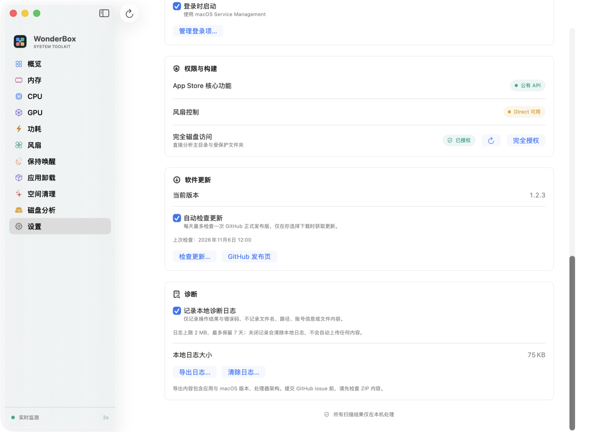

## 安装

要求 **macOS 14 或更新版本**，支持 Apple Silicon 和 Intel。从 [Releases](https://github.com/jasonwong1991/WonderBox/releases/latest) 下载 ZIP，解压后将 `WonderBox.app` 放入「应用程序」。

当前发行包为 **ad-hoc 临时签名，未经 Apple 公证**，macOS 可能阻止首次打开。确认下载来自本项目后，可按系统提示进入**系统设置 → 隐私与安全性 → 仍要打开**。以下命令仅移除该应用的隔离标记，并不验证发布者身份：

```bash
xattr -dr com.apple.quarantine /Applications/WonderBox.app
```

升级前退出旧版，再替换应用。已安装卸载监测插件时，更新后点击**重启插件**。不要覆盖仍在运行的应用。

### 按功能申请权限

| 功能 | 所需访问 |
| --- | --- |
| 基础监控、保持唤醒、应用盘点 | 不需要管理员授权 |
| 完整主目录／受保护目录扫描 | 为实际运行的应用副本开启完全磁盘访问（可选） |
| 废纸篓统计／清空、适用的受保护文件移除 | Finder 自动化；Finder 可能请求系统身份验证 |
| 风扇写入、内存优化 | 安装／更新固定指令辅助服务时请求管理员授权 |
| 选中的系统缓存清理 | 每次执行请求管理员授权 |
| 卸载监测／登录时启动 | macOS 服务管理，可能需批准登录项 |

管理员权限不等于隐私权限。卸载不安装辅助服务；辅助服务会验证调用者签名与用户 ID，只接受固定操作，不执行调用方提供的任意 Shell 命令。

## 构建与测试

使用 Xcode 的 macOS SDK 和 Swift 6：

```bash
git clone https://github.com/jasonwong1991/WonderBox.git
cd WonderBox
swift test
python3 -m unittest discover -s Tests/Packaging
python3 scripts/sync_localization.py --check
./scripts/package_app.sh
open build/WonderBox.app
```

`package_app.sh` 生成本地签名应用，包含编译后的字符串目录、生成图标、维护辅助程序与内嵌卸载监测插件。设置 `UNIVERSAL=1` 可构建 Apple Silicon＋Intel 通用二进制。`swift run` 适合开发，但不生成可注册的插件包，也不将字符串目录编译到应用资源。打包不会自动发布 Release。

当前发行方式是**直接分发**。App Store 分发需排除私有传感器接口和辅助程序，并将文件操作限定到沙盒授权范围；仓库里的 entitlements 文件不代表现有应用已可直接上架。详见[分发方式、API 边界与硬件验收](docs/DISTRIBUTION.md)。

### 本地化与参与贡献

文本位于 `Sources/WonderBox/Resources/Localizable.xcstrings` 和 `InfoPlist.xcstrings`。新增语言时翻译两份目录，将语言代码加入 `scripts/sync_localization.py` 的 `LANGUAGES` 和 `Sources/WonderBox/Core/Localization.swift` 的 `AppLanguage`，再执行本地化检查及测试。不带 `--check` 运行同步脚本会提取源码字符串并更新键列表。

反馈问题请附上应用／macOS 版本、Mac 型号、预期与实际表现及复现步骤。传感器问题请区分不可用（`—`）与真实零值。诊断导出请检查后再附上。交流社区：[LinuxDo](https://linux.do)。

## 许可与致谢

[MIT](LICENSE) · [第三方声明](THIRD_PARTY_NOTICES.md)。WonderBox 应用与菜单栏图标由仓库内代码生成，不内嵌第三方标识；SF Symbols 用于原生 macOS 界面。截图中应用图标的权利归各自所有者。
